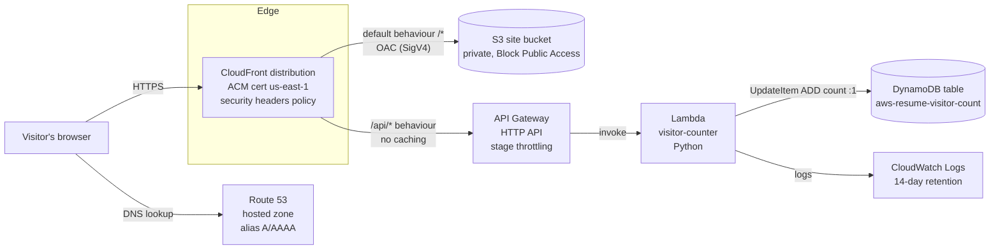
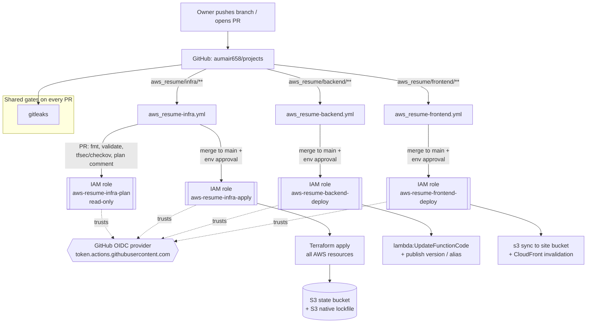

# aws_resume: Architecture Overview

Status: **Accepted** (2026-10-28). See the [design security review](../security/design-review-2026-10-28.md) for required follow-ups
Date: 2026-10-23
Author: aws-resume-architect subagent

This document describes the proposed architecture for the AWS-hosted resume
site. The decisions behind it are recorded as ADRs in [`adr/`](adr/). They
were accepted by the owner on 2026-10-28. Anything below that rests on
an **assumption** about the owner's preferences is marked _(assumption)_ and
repeated under [Open questions](#open-questions).

---

## 1. Context and goals

The owner is building a personal resume website on AWS. The site matters,
but the bigger goal is to practise production-style AWS, Terraform and
DevSecOps work and be able to explain every part of it in an interview.

**Goals**

1. Serve a static resume site over HTTPS on a custom domain, with good
   performance worldwide.
2. Add a small dynamic backend, a **visitor counter** _(assumption: the only
   backend feature for v1)_. It exercises API Gateway, Lambda, DynamoDB and IAM.
3. Define all infrastructure in Terraform. Changes reach AWS only through
   three GitHub Actions pipelines (infra, backend, frontend), each using its
   own least-privilege OIDC role.
4. Make security scanning (tfsec/checkov, Semgrep, gitleaks) a merge gate.
5. Stay at or near **$0–2/month**. Nothing should bill meaningfully while
   idle except DNS.
6. Make the whole stack reproducible: `destroy` and re-`apply` from code,
   with only the documented bootstrap steps done by hand.

**Non-goals (explicitly out of scope for v1)**

- No server-side rendering, CMS, or user accounts/auth on the site.
- No VPC, NAT gateway, EC2, containers or RDS. Nothing in the design needs a
  network you have to manage, and NAT alone would cost about $32/month while idle.
- No multi-region, multi-account or multi-environment (dev/stage/prod) setup.
  There is one environment, called `prod`. The [open questions](#open-questions)
  revisit a separate account.
- No unique-visitor deduplication (it would mean storing IPs or fingerprints,
  which are personal data).
- No WAF in v1. It costs at least $5/month while idle. See ADR-0001 for when to add it.
- No custom observability stack. CloudWatch only.

---

## 2. Component diagram

### 2.1 Request flow (user → data store)



How a request travels:

1. The browser resolves `example.com` _(placeholder domain)_. Route 53 answers
   with an alias record pointing at the CloudFront distribution.
2. CloudFront terminates TLS using an ACM certificate. The certificate must
   live in `us-east-1` for CloudFront.
3. Static paths (`/*`) come from a **private** S3 bucket. CloudFront signs its
   requests with **Origin Access Control (OAC)**, and the bucket policy only
   accepts requests from this distribution.
4. `/api/*` is forwarded uncached to an **API Gateway HTTP API**, which invokes
   the Lambda function. The site and the API share one origin, so there is
   no CORS to configure.
5. Lambda increments a counter atomically in DynamoDB and returns the new
   value.

### 2.2 CI/CD flow



**Ownership boundary between pipelines** (this is a key design choice):

- The **infra** pipeline owns every AWS resource, including the Lambda
  *function* and the S3 *bucket*. It creates the function from a placeholder
  zip and tells Terraform to ignore later code changes
  (`lifecycle { ignore_changes = [filename, source_code_hash] }`).
- The **backend** pipeline only ships *code*. It updates the existing
  function's code, publishes a version and moves the `live` alias. It
  cannot create, delete or reconfigure anything.
- The **frontend** pipeline only ships *content*. It syncs files into the
  existing bucket and invalidates the existing distribution.

As a result, no pipeline's role can do another pipeline's job, and a
compromised backend or frontend workflow cannot change IAM, DNS or
infrastructure.

---

## 3. Component table

| # | Component | AWS service | Why it's there | Owning pipeline | ADR |
|---|---|---|---|---|---|
| 1 | Static site storage | S3 (private bucket, SSE-S3, versioning, Block Public Access) | Holds HTML/CSS/JS. Durable, cheap, no server | Bucket: **infra**. Objects: **frontend** | 0001 |
| 2 | CDN and TLS edge | CloudFront + OAC + managed `SecurityHeadersPolicy` response headers | HTTPS, caching, security headers, a single origin for site and API, keeps the bucket private | **infra** (invalidations: **frontend**) | 0001 |
| 3 | TLS certificate | ACM (us-east-1, DNS-validated) | Free public cert for the custom domain. Auto-renews through its DNS validation record | **infra** | 0005 |
| 4 | DNS | Route 53 hosted zone + alias A/AAAA + CAA records | Resolves the domain to CloudFront. Alias queries to CloudFront are free | Zone records: **infra**. Domain purchase: **manual bootstrap** | 0005 |
| 5 | API front door | API Gateway HTTP API (`$default` stage, throttling) | Managed HTTPS endpoint with rate limiting, and a widely recognised component | **infra** | 0003 |
| 6 | Compute | Lambda (Python, arm64, `live` alias) | Runs the counter logic. Costs nothing while idle | Function: **infra**. Code: **backend** | 0003 |
| 7 | Data store | DynamoDB (provisioned 1 RCU / 1 WCU, PITR on, AWS-owned key) | Atomic counter. The capacity limit acts as a cost ceiling | **infra** | 0004 |
| 8 | Logs and alarms | CloudWatch Logs (14-day retention), CloudWatch alarms → SNS email | Debugging and alerting on 5xx and Lambda errors/throttles | **infra** | — |
| 9 | Spend guardrail | AWS Budgets (monthly $5 budget, alerts at 50/80/100%) | Catches cost surprises early | **manual bootstrap** (exists before anything else) | 0007 |
| 10 | CI identity | IAM OIDC provider + 4 IAM roles | Keyless, short-lived CI credentials, one role per pipeline (infra split into plan/apply) | **manual bootstrap** | 0006 |
| 11 | Terraform state | S3 state bucket (versioned, SSE, TLS-only) using S3 native locking | Shared state for CI. No DynamoDB lock table needed | **manual bootstrap** | 0007 |

---

## 4. Security

### 4.1 Trust boundaries

| Boundary | What crosses it | Control |
|---|---|---|
| Internet → CloudFront | Anonymous HTTPS requests | TLS 1.2+ (`TLSv1.2_2021` minimum protocol policy), HTTP→HTTPS redirect, managed security-headers policy (HSTS, X-Content-Type-Options, X-Frame-Options, Referrer-Policy) plus a custom CSP, AWS Shield Standard (free, automatic) |
| CloudFront → S3 | Signed origin fetches | OAC (SigV4). Bucket policy allows `s3:GetObject` only for principal `cloudfront.amazonaws.com` with `AWS:SourceArn` = this distribution. Block Public Access is on (all four flags) |
| CloudFront → API Gateway | Forwarded `/api/*` requests | HTTPS only. **Known gap:** the `execute-api` URL can also be reached directly. Accepted for v1 because the stage throttling and the DynamoDB capacity limit cap the damage. See ADR-0003 for the options to close it |
| API Gateway → Lambda | Invocation | Lambda resource policy limited to this API's ARN |
| Lambda → DynamoDB | Read/write | Execution role allows `dynamodb:UpdateItem` and `GetItem` on **one table ARN** only, plus write access to its own log group |
| GitHub → AWS | CI deployments | OIDC federation. No stored keys. Each role's trust policy is pinned to `repo:aumair658@58346411/projects@1337327941` **and** a specific GitHub Environment or event (ADR-0006) |
| Owner laptop → AWS | Bootstrap only | Admin credentials are used locally for the one-time bootstrap (state bucket, OIDC roles, budget, domain purchase), then put away. MFA on the account. No long-lived access keys after bootstrap (use SSO / `aws login` sessions) |

### 4.2 IAM roles per pipeline

All CI roles trust the account's existing GitHub OIDC provider. The
`tf_pr_reviewer` bootstrap already created it, and AWS allows only one per
URL, so aws_resume **looks it up with a data source rather than creating it**.

| Role | Assumable when (`sub` claim) | Permissions (summary) |
|---|---|---|
| `aws-resume-infra-plan` | `repo:aumair658@58346411/projects@1337327941:pull_request` | `ReadOnlyAccess`-style read on the managed services. Read on the state object. Read/write/delete **only** on the `*.tflock` lock object. No write to any resource |
| `aws-resume-infra-apply` | `repo:aumair658@58346411/projects@1337327941:environment:aws-resume-prod-infra` (environment with required reviewer, as all three are) | Create/update/delete on the stack's resources, scoped by `aws-resume-*` name prefix where the service supports it. May create IAM roles **only with the `aws-resume-boundary` permissions boundary attached** (prevents privilege escalation). State read/write |
| `aws-resume-backend-deploy` | `repo:aumair658@58346411/projects@1337327941:environment:aws-resume-prod-backend` | `lambda:UpdateFunctionCode`, `PublishVersion`, `UpdateAlias`, `GetFunction*` on **one function ARN** |
| `aws-resume-frontend-deploy` | `repo:aumair658@58346411/projects@1337327941:environment:aws-resume-prod-frontend` | `s3:ListBucket` on the site bucket. `s3:PutObject`/`DeleteObject` on `site-bucket/*`. `cloudfront:CreateInvalidation` on **one distribution ARN** |
| `aws-resume-visitor-counter-exec` (runtime, not CI) | `lambda.amazonaws.com` | `dynamodb:UpdateItem`/`GetItem` on one table. Logs on one log group |

Lesson from sibling projects: `tf_pr_reviewer/bootstrap/main.tf` trusts
`repo:<repo>:*`. That lets **any** workflow, on **any** branch or PR in the
monorepo, assume a role that can apply infrastructure. aws_resume should not
copy that. See ADR-0006.

### 4.3 Data classification

| Data | Classification | Where | Notes |
|---|---|---|---|
| Resume content (HTML, PDF) | **Public** | S3 site bucket, Git | Intentionally public. Take care not to commit a home address or phone number you don't want indexed |
| Visitor count | **Public** | DynamoDB | A single integer. No PII |
| Request logs (Lambda, API GW access logs, CloudFront standard logs) | **Internal** | CloudWatch Logs, 14-day retention | Can contain source IPs (personal data in some jurisdictions). Short retention, not exported |
| Terraform state | **Confidential** | S3 state bucket | Contains resource ARNs and config, no secrets by design. Versioned, encrypted, TLS-only, no public access |
| CI role ARNs | **Internal (non-secret)** | GitHub Actions *variables* | A role ARN on its own grants nothing. Matches the sibling-project convention |

### 4.4 Secrets inventory

The design deliberately has **no application secrets**:

- No AWS access keys (OIDC).
- No API keys. The counter API is public by design.
- No database passwords. DynamoDB uses IAM.
- `GITHUB_TOKEN` is managed by GitHub, scoped per workflow, and expires with the job.

If a secret is ever added (for example a CloudFront→API shared header, or a
third-party analytics key), it goes in **SSM Parameter Store SecureString**
(free standard tier). Following the `tf_pr_bot` pattern, Terraform creates a
placeholder and the real value is set out-of-band, so it never lands in
state. gitleaks runs on every PR as the safety net.

### 4.5 Encryption

- In transit: HTTPS everywhere (viewer → CloudFront, CloudFront → origins,
  API GW → Lambda is AWS-internal). The state bucket policy denies
  `aws:SecureTransport = false`.
- At rest: SSE-S3 on both buckets and the AWS-owned key on DynamoDB. A
  **customer-managed KMS key is deliberately not used**: it costs $1/month
  per key while idle and adds no real protection for public data. tfsec and
  checkov will flag this (for example "no CMK"). Record those as documented
  suppressions with a reason, not silent ignores.

---

## 5. Operability

- **Logging:** Lambda logs go to CloudWatch with 14-day retention. API Gateway
  access logs are on (JSON, 14 days). CloudFront standard logging is **on**,
  delivered to a private, encrypted `aws-resume-cf-logs-<account-id>` S3
  bucket with a **30-day lifecycle expiry**. Use the newer logging delivery
  (v2) so the log bucket doesn't need ACLs enabled. The logs contain viewer
  IPs (personal data), so retention stays short and they are never exported.
- **Alarms** (CloudWatch, 10 free per month): Lambda `Errors > 0` (5 min),
  Lambda `Throttles > 0`, API GW `5xx > 0`, DynamoDB
  `ThrottledRequests > 0`, CloudFront `5xxErrorRate > 5%`. CloudFront metrics
  live in us-east-1, which is another reason to stay in that region. All
  alarms notify an SNS topic with an email subscription.
- **Budget:** $5/month with email alerts at 50%, 80% and 100% actual, plus
  100% forecasted. It is created in bootstrap so it exists before any spend.
- **Teardown/rebuild:** everything except bootstrap resources and the domain
  registration can be destroyed and recreated by `terraform destroy/apply`.
  The site bucket uses `force_destroy = false`. A destroy needs a deliberate
  bucket empty first, which is documented.

---

## 6. Region

**us-east-1** _(assumption)_. Reasons: the ACM certificate for CloudFront
must be in us-east-1 anyway, CloudFront metrics and alarms live there, the
sibling projects already use it (`AWS_REGION: us-east-1` in
`.github/workflows/tf_pr_reviewer-terraform.yml`), and a single region keeps
the Terraform free of provider aliases. Latency to the API is a non-issue for
a counter.

---

## 7. Cost estimate

Prices were checked on 2026-10-23 against the AWS pricing pages (see the
ADRs for sources). The traffic assumption is about 5,000 page views per
month, which is generous for a personal resume.

| Item | Unit price | Expected usage | Est. monthly |
|---|---|---|---|
| Route 53 hosted zone | $0.50/zone/month | 1 zone | **$0.50** (bills while idle) |
| Route 53 queries | $0.40/M standard. Alias → CloudFront is free | almost all alias | ~$0.00 |
| Domain registration (.com) | ~$15/year _(varies by TLD, check at purchase)_ | 1 | **~$1.25** (bills while idle) |
| ACM public cert | free | 1 | $0.00 |
| CloudFront | Always-free tier: 1 TB out + 10M requests/month | <1 GB, <50k req | $0.00 |
| S3 (site + state) | ~$0.023/GB-month + requests | <50 MB | ~$0.01 |
| API Gateway HTTP API | $1.00/M requests (account is older than 12 months, so no API Gateway free tier) | ~5k | ~$0.01 |
| Lambda | Always-free: 1M requests + 400k GB-s/month | ~5k invocations | $0.00 |
| DynamoDB | Always-free: 25 GB + 25 RCU/25 WCU provisioned | 1 RCU / 1 WCU, KB of data | $0.00 |
| DynamoDB PITR | ~$0.20/GB-month | KB | ~$0.00 |
| CloudWatch Logs / alarms | 5 GB logs free, 10 alarms free | <100 MB, 5 alarms | $0.00 |
| CloudFront standard logs (S3) | S3 storage for the logs, 30-day expiry | <100 MB | ~$0.00 |
| SNS email | 1,000 email notifications free | a handful | $0.00 |
| AWS Budgets | budgets without actions are free | 1 | $0.00 |
| **Total** | | | **~$1.75/month** with a custom domain, **~$0.01/month** without |

**Items that bill while idle:** the Route 53 hosted zone ($0.50) and the
domain registration. Nothing else does. Optional add-ons that would add idle
cost: WAF (≥$5/month), a customer-managed KMS key ($1/month per key), Route
53 DNSSEC (needs a KMS key, so $1/month).

**Abuse cost ceiling:** an attacker hitting `/api/*` directly is limited by
the API stage throttle (proposed 10 rps steady / 20 burst) and the DynamoDB
1 WCU limit. Throttled requests are rejected rather than billed for capacity.
Requests that reach API Gateway are still billed at $1/M, so a sustained
flood of 10 rps would cost about $26/month. The budget alert catches that
within days. WAF rate limiting is the escalation path (ADR-0001).

---

## 8. Proposed repository layout

Following the monorepo conventions from `tf_pr_reviewer` (workflows at the
repo root, namespaced as `<project>-<purpose>.yml`, with path filters):

```
aws_resume/
  PLAN.md
  docs/architecture/          # this doc + adr/
  infra/
    bootstrap/                # local state, run once by hand (state bucket, OIDC roles, boundary, budget)
    *.tf                      # main stack (remote state), modules/ as needed
  backend/                    # Lambda source + tests
  frontend/                   # static site source
.github/workflows/
  aws_resume-infra.yml
  aws_resume-backend.yml
  aws_resume-frontend.yml
```

`PLAN.md` calls the workflows `infra.yml`, `backend.yml` and `frontend.yml`.
This design proposes the `aws_resume-` prefix to match the existing
`tf_pr_reviewer-terraform.yml` convention and avoid clashes in the shared
`.github/workflows/` directory.

---

## 9. ADR index

| ADR | Title | Status |
|---|---|---|
| [0001](adr/0001-static-site-hosting.md) | Static site hosting: private S3 + CloudFront with OAC | Accepted |
| [0002](adr/0002-infrastructure-as-code-tool.md) | IaC tool: Terraform | Accepted |
| [0003](adr/0003-backend-runtime.md) | Backend runtime: API Gateway HTTP API + Lambda (Python) | Accepted |
| [0004](adr/0004-data-store.md) | Data store: DynamoDB, provisioned minimal capacity | Accepted |
| [0005](adr/0005-domain-and-dns.md) | Domain and DNS: Route 53 + ACM, custom domain | Accepted |
| [0006](adr/0006-ci-authentication.md) | CI authentication: GitHub OIDC, environment-pinned roles per pipeline | Accepted |
| [0007](adr/0007-terraform-remote-state.md) | Terraform remote state: dedicated S3 bucket with native locking | Accepted |

---

## Owner decisions (answered 2026-10-28)

The answers below are already reflected in this overview and the ADRs.

| # | Question | Decision |
|---|---|---|
| 1 | Custom domain? | **Yes.** The owner will buy one in Route 53 (ADR-0005). The domain name is still to be chosen. The code keeps the domain optional until then |
| 2 | Region | **`us-east-1`** |
| 3 | Backend scope | **Visitor counter only** for v1. No PII-handling features |
| 4 | Frontend | **Plain HTML/CSS plus vanilla JS**, with a clean, polished design. No framework or build step beyond minification |
| 5 | AWS account | **Same account** as the sibling projects. Group resources with the `aws-resume-` name prefix and the `Project = aws-resume` tag (ADR-0002) |
| 6 | Free-tier type | **Legacy account**, created well before 15 July 2025. The 12-month free tier has ended. Always-free tiers (Lambda, DynamoDB, CloudFront, CloudWatch) still apply. API Gateway bills at $1/M requests from the first request (cents at this scale) |
| 7 | Lambda language | **Python** |
| 8 | CloudFront logs | **On.** Standard logs go to a private S3 bucket with 30-day expiry (§5). They help debugging and security forensics and satisfy the scanner check. Short retention because they contain viewer IPs |
| 9 | CloudFront flat-rate plan | **Stay on pay-as-you-go** with the always-free tier for v1. Revisit if the flat-rate plan's bundled WAF becomes attractive |
| 10 | Approval gates | **Required reviewer on all three** environments: `aws-resume-prod-{infra,backend,frontend}`. The repo is public, so environment protection rules are free |

### Still open

- **Domain name:** the code keeps the domain optional until it's bought.
